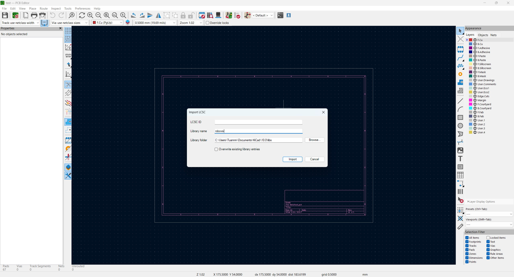
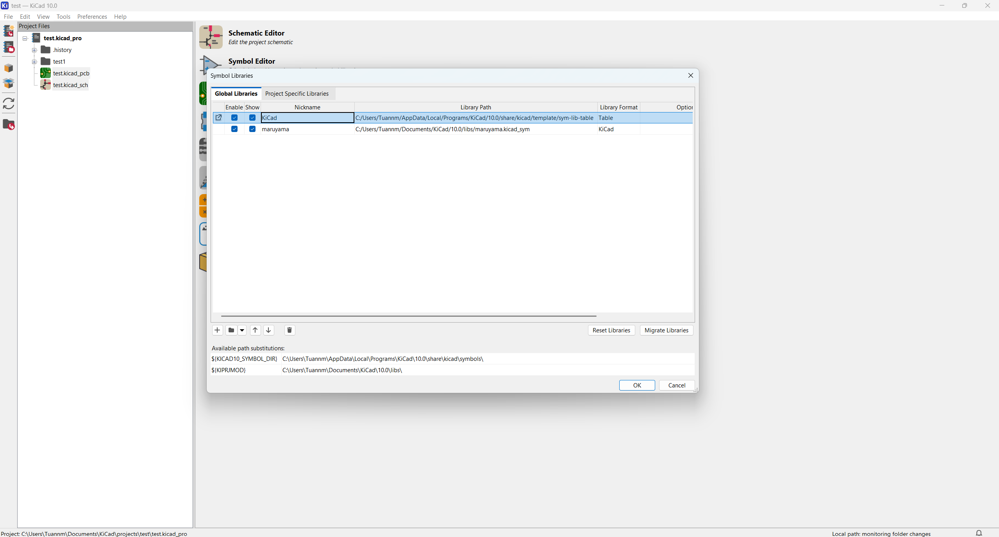
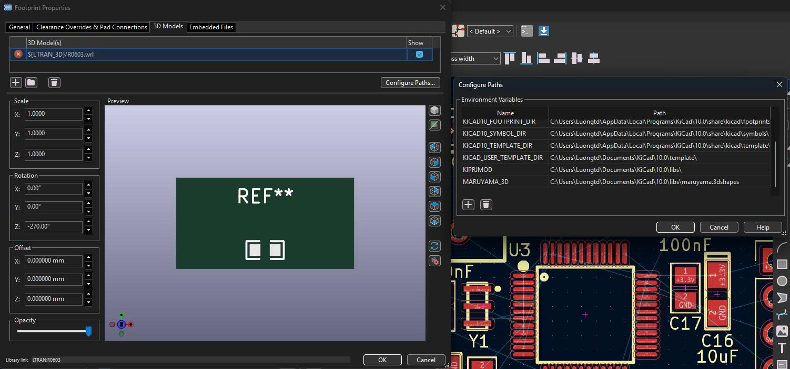

# KiCad LCSC Importer

A plugin for KiCad 10 on Windows. Enter an LCSC part number to export the symbol, footprint, and 3D model (if available) to a library of your choice.

<p align="center">
  
</p>

## Installation and usage

1. Download `kicad-lcsc-importer.zip` from the repository's **Releases** section.
2. In KiCad Manager, open **Plugin and Content Manager → Install from File…** and select the ZIP. If you installed a company-branded release, uninstall it and click **Apply Pending Changes** before installing this ZIP. The new package uses a different identifier.
3. In **Preferences → Plugins**, turn on **Enable KiCad API**. Use the Python installation bundled with KiCad. KiCad installs the dependencies into the plugin's own environment the first time it loads.
4. Reopen PCB Editor and click **Import LCSC**  in the toolbar. Enter a part number such as `C116151` and a **Library name** such as `my_parts`, then click **Import**. The default library name is `lcsc_importer`. Library names can contain letters A–Z, digits, underscores, and hyphens. Windows device names are reserved.

If multiple parts share a footprint, the converter may stop when it encounters an existing file. Select **Overwrite existing library entries** to replace duplicate entries.

The dialog remembers the library name from your last successful import and fills it in the next time you open it.

## Add the exported symbol and footprint libraries

In each library dialog, choose **Global Libraries** to use the library across projects or **Project Specific Libraries** to use it in the current project. Browse to the **Library folder** you selected during import. The default is `Documents/KiCad/10.0/libs`, or `10.0/libs` under `KICAD_DOCUMENTS_HOME` if that environment variable is set.

1. In Schematic Editor, open **Preferences → Manage Symbol Libraries…**. Click the folder icon to add an existing library, select `my_parts.kicad_sym`, set the nickname to `my_parts`, and click **OK**.
2. In PCB Editor, open **Preferences → Manage Footprint Libraries…**. Click the folder icon to add an existing library, select the `my_parts.pretty` folder, set the nickname to `my_parts`, and click **OK**. Use the library name from the import so the symbol’s footprint link resolves.

<p align="center">
  
</p>

See the [KiCad guide to symbol and footprint libraries](https://docs.kicad.org/10.0/en/getting_started_in_kicad/getting_started_in_kicad.html) for more about library tables.

## Configure the 3D model path

If the import includes a 3D model, set up the path variable shown in the import result. The plugin uppercases the library name and adds `_3D`, so `my_parts` uses `MY_PARTS_3D`.

1. In PCB Editor, open **Preferences → Configure Paths…**. You can also click **Configure Paths…** from **Footprint Properties → 3D Models**.
2. Click **+**. Enter `MY_PARTS_3D` in **Name** and the full path to `my_parts.3dshapes` in **Path**. That folder is inside the export folder. Use distinct library names for libraries in different folders that you want to use together.
3. Click **OK**, then check the **3D Models** preview for the imported footprint. If a model path starts with `${MY_PARTS_3D}`, KiCad resolves it using the folder you configured. The variable in **Configure Paths** must match the name inside `${…}` in the model path.

<p align="center">
  
</p>

## Updating and packaging

The plugin uses [uPesy's easyeda2kicad](https://github.com/uPesy/easyeda2kicad.py) from [PyPI](https://pypi.org/project/easyeda2kicad/). The version is pinned in `plugins/requirements.txt` so every installation uses the same converter version. The upstream source code is licensed under AGPL-3.0.

When a new upstream version is released, update the pin in `plugins/requirements.txt`, bump the plugin version in `metadata.json`, and test importing a part with a 3D model. The plugin reads the footprint path from the converter's log when linking 3D models, so verify that the footprint still resolves its model through the library's path variable after upgrading.

To build the installation ZIP, open PowerShell in the repository root and run `build.py` with the console Python bundled with KiCad 10. This command uses the per-user installation path on Windows.

```powershell
& "$env:LOCALAPPDATA\Programs\KiCad\10.0\bin\python.exe" .\build.py
```

If KiCad is installed in a different directory, use the path to `bin\python.exe` inside that installation.

Attach `dist/kicad-lcsc-importer.zip` to the GitHub Release. Users can download the ZIP and install it directly in KiCad.
